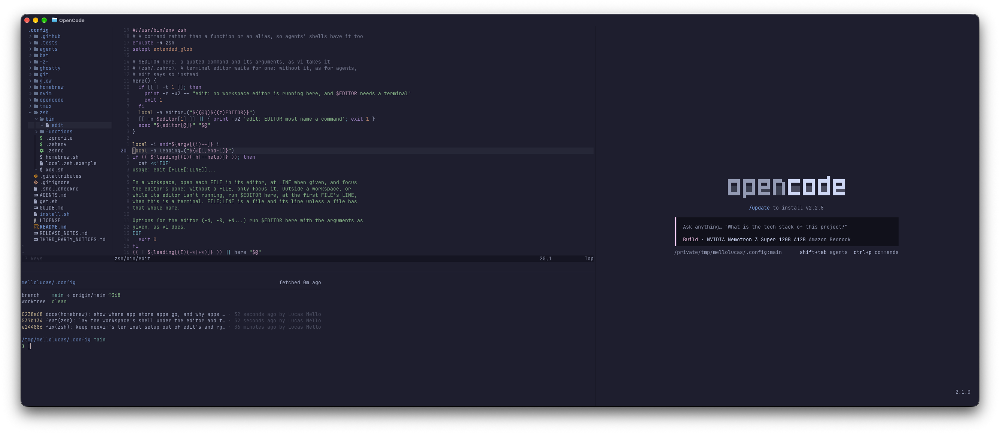

# .config

A Mac-first terminal workspace where each task gets its editor, agent, and shell: Neovim, a coding agent, and zsh side by side in Ghostty, set up in one command. The [goals in AGENTS.md](AGENTS.md#goals) say what matters.



```sh
sh -c "$(curl -fsSL https://raw.githubusercontent.com/mellolucas/.config/HEAD/get.sh)"
exec zsh -l
keys start
```

On a Mac, these install the setup, start a shell that has it, and show the essentials in a minute. [Get started](#get-started) covers the rest, Linux and WSL included.

## Get started

macOS is the primary platform; Linux, WSL, and GitHub Codespaces get best-effort support for the essentials, with tmux where Ghostty is absent ([Without Ghostty](#without-ghostty)), and fresh Linux installs aren't validated yet.

`get.sh` clones this repository to `~/code/mellolucas/.config` and runs its installer; on a Mac without the Command Line Tools, Homebrew's installer adds them, Git included, first, when your account is an administrator ([Standard accounts](#standard-accounts) covers the others). If something fails, run the same command again: it reuses the checkout. Keep the `sh -c` form, which leaves Homebrew's installer a terminal to ask for your password.

- To clone elsewhere, start the command with `DOTFILES_DIR=~/path/to/checkout`, outside `$XDG_CONFIG_HOME` (normally `~/.config`), which the installer links into.
- To set up only the configuration (as root on a server, or on Alpine), end the command with `-- link`: arguments after `--` go to the installer.

Or clone the repository yourself (on a Mac, `git` first offers to install the Command Line Tools), then install:

```sh
git clone https://github.com/mellolucas/.config ~/code/mellolucas/.config
cd ~/code/mellolucas/.config
./install.sh install
exec zsh -l
```

Installation links each configuration directory into `$XDG_CONFIG_HOME`, adds the `~/.zshenv` entrypoint, the `dotfiles` and `edit` commands, and the agents' shared instructions, then installs Homebrew if needed and applies the Brewfile. Conflicting files move to timestamped backups, and rerunning is safe. Skip the "Next steps" Homebrew prints: `zsh/.zprofile` already loads Homebrew, and following them leaves a `~/.zprofile` this setup ignores.

### Linux and WSL

Install Git and zsh first; on Ubuntu and WSL, `sudo apt install zsh build-essential procps curl file git` covers Homebrew's needs too. On WSL, keep the checkout in the Linux file system, not under `/mnt/c`. After installing, make zsh your login shell: `chsh -s "$(command -v zsh)"`.

### Standard accounts

On a Mac account that isn't an administrator, an administrator sets up two things once: the Command Line Tools, and a Homebrew your account owns, as Homebrew's guides describe ([Installation](https://docs.brew.sh/Installation#running-without-sudo), [Homebrew for Mac Admins](https://docs.brew.sh/Homebrew-for-Mac-Admins)). Its package, `Homebrew.pkg`, makes the account logged in at the Mac's screen the owner by default, whoever runs it (the guides show how to name another), while its shell installer makes the account running it the owner. When `Homebrew.pkg` comes without a notarization ticket attached, as 7.0.12 does, macOS checks online, and where a network blocks that check, macOS refuses a copy downloaded in a browser: choose Open Anyway in System Settings › Privacy & Security, or run `sudo installer -pkg Homebrew.pkg -target /` in Terminal. Then run the command above from your account.

On such an account, casks go to `~/Applications`, and Homebrew itself never asks for sudo, so casks that run an installer package come from an administrator. So do App Store apps, as `mas` asks for sudo on its own: leave them out of `local.Brewfile` there, or list their ids in `HOMEBREW_BUNDLE_MAS_SKIP`. Where Homebrew belongs to another account by design, packages come from that account, and `dotfiles doctor` says whose it is.

### Package sets

The lean set, `homebrew/core.Brewfile`, holds the essentials on every platform: Git, Neovim, the shell tools, tmux, gh, and OpenCode. `homebrew/Brewfile` adds the workstation: the language servers; the Go, Node, Bun, and Python runtimes; Copilot CLI and Codex, from npm because macOS blocks their unnotarized Homebrew casks; on macOS, Ghostty, Claude Code, Obsidian, and the App Store CLI (when signed in to an Apple Account); and Apple's Container on Apple silicon with macOS 26+.

GitHub Codespaces, dev containers, and Docker or Podman containers bring their own toolchains and get only the lean set. To choose it elsewhere, such as on a server you run rather than develop on, export `HOMEBREW_BUNDLE_FILE_GLOBAL="${XDG_CONFIG_HOME:-$HOME/.config}/homebrew/core.Brewfile"` before the first install, and keep that line in `zsh/local.zsh`.

### First run

Open Ghostty, then:

1. Copy `~/.config/git/config.d/personal.example` (or `work.example`) to `personal` (or `work`) beside it, and fill in your identity and signing key (its comments show how to create one); Git refuses to commit until an identity exists.
2. Run `gh auth login`; Git uses it for GitHub credentials.
3. Log in to each agent you use (`opencode`, `claude`, `copilot`, `codex`) through its own flow.
4. If you use Time Machine, run `tmutil addexclusion ~/.cache` once: it skips `~/Library/Caches`, not `~/.cache`.
5. Run `dotfiles doctor`: it checks the links, login shell, Homebrew, tools, GitHub login, and Git identity, names a fix for each problem, and ends with "no problems found".
6. In a project, run `workspace`.

## Daily use

Start a project with **`workspace`**: the editor above a shell on the left, the agent on the right at full height. In a repository, `workspace --task NAME` lays out a task in a worktree and branch of its own beside the checkout, and reopens it later with the agent's last session; `workspace --done` removes the worktree, and the branch once it's merged. `v FILE:LINE`, `rgv`, `fzfv`, and agents (through `edit`) open files in the workspace's editor.

Run **`keys`** to browse the [field guide](GUIDE.md) with a preview of each page, or type to search every line; `keys TOPIC` opens a page (`keys git`), and `keys WORDS` searches from the prompt (`keys close tab`). `help COMMAND` shows any command's help, even through an alias.

Agents: OpenCode is the workspace default; Claude Code, Copilot CLI (also `gh copilot`), and Codex are installed too. All four read `agents/instructions.md`, this setup's notes for every repository (how to show you a file, the tools at hand, and no pushing or rewriting shared history unless asked): Codex as `AGENTS.md`, Claude Code as `CLAUDE.md`, and Copilot CLI as `copilot-instructions.md`, each linked in its home, and OpenCode through its config. To keep your own instructions instead, put a file in place of an agent's link; the installer leaves it. Agents notify you when they finish or need you while you're elsewhere (inside tmux, only from panes in sight); Copilot CLI's notifications start off: run `copilot config notifications on` and `copilot config terminalNotifications on`.

Colors follow Catppuccin, Mocha in dark mode and Latte in light, switching with the system appearance in Ghostty, Neovim (once its pane regains focus), OpenCode, fzf, bat, Delta, Glow, and the prompt; Glow's code blocks keep Latte colors in dark mode.

## Maintain the setup

```sh
dotfiles update    # Update the repository, relink, apply the Brewfile, update its npm packages
dotfiles bundle    # Apply the Brewfile and local.Brewfile, then update their npm packages
dotfiles link      # Relink configuration without touching packages
dotfiles doctor    # Check the setup; names fixes and exits 1 on problems
dotfiles uninstall # Remove the links this repository owns; packages, backups, and data stay
```

Nothing checks for updates in the background: a week after the last complete `install`, `update`, or `bundle`, the first shell of each day reminds you to run `dotsup` (`dotfiles update`). The Brewfile owns package updates: Ghostty's and Copilot CLI's updaters are off, OpenCode only notifies, and Obsidian's updater can be turned off in its settings. Homebrew refreshes its package list once it is a day old; `brew update` refreshes it at once. Homebrew Bundle never upgrades Brewfile `npm` entries, so `update` and `bundle` do, without install scripts and only to releases at least a day old. `update` needs a clean checkout that can fast-forward; `update --discard` resets local changes instead.

Neovim plugins are the one thing Homebrew does not update: run `:lua vim.pack.update()` in Neovim, review the changes, `:write` to apply them (`:quit` skips), then commit the changed `nvim/nvim-pack-lock.json`.

## Without Ghostty

Where Ghostty is absent (GitHub Codespaces, WSL, SSH sessions, other terminals), tmux runs the panes with its own keys after its prefix, `Ctrl+B`, and `workspace` lays out a tmux session named after the directory, which rerunning `workspace` there reattaches. Icons in `ll` and Neovim's file tree need a font with Nerd Font symbols, which Ghostty includes.

- **GitHub Codespaces**: in your GitHub settings, under Codespaces, turn on *Automatically install dotfiles* and choose this repository. Each new codespace installs the lean set and makes zsh the login shell, so `gh codespace ssh` lands in zsh. VS Code's terminal there still opens bash until you set `"terminal.integrated.defaultProfile.linux": "zsh"`, which Settings Sync carries to every codespace. `dotfiles doctor` lists the image's own shell files (`.oh-my-zsh`, `.zshrc`, `.zprofile`); zsh ignores them, so they can stay or go. Codespaces lack Ghostty's terminfo entry, which tmux needs, so zsh switches those sessions to `xterm-256color`; to reach hosts without these dotfiles from Ghostty, put `TERM=xterm-256color` before the command.
- **WSL**: in Windows Terminal 1.22 or newer, add the [Catppuccin schemes](https://github.com/catppuccin/windows-terminal), set `"theme": "system"`, and give the WSL profile `"colorScheme": {"dark": "Catppuccin Mocha", "light": "Catppuccin Latte"}` and `"environment": {"COLORTERM": "truecolor"}`.
- **VS Code's terminal**: use the [Catppuccin theme](https://github.com/catppuccin/vscode) with `window.autoDetectColorScheme`.
- **Linux desktops**: the Brewfile installs Ghostty and Claude Code on macOS only; use their own installers. Ghostty on Linux keeps its own pane keys (its command palette lists them), and `Ctrl+W h/j/k/l` moves between Neovim's windows.
- **Servers** (SSH only): install as a normal user with sudo; Homebrew refuses root outside containers, so as root `./install.sh link` sets up only the configuration. Choose the lean set ([Package sets](#package-sets)) on a server you run rather than develop on. A `workspace` survives a dropped connection: run it again in the same directory to reattach. Pushing to GitHub over HTTPS goes through `gh`; without it, use SSH remotes.
- **Plain containers** (`docker exec`, `podman exec`): Docker and Podman containers get the lean set by themselves; Kubernetes pods need it chosen. Homebrew doesn't support musl distributions such as Alpine: run `./install.sh link` and install zsh, tmux, and Neovim from the system's packages. Neovim 0.10 and 0.11 start without plugins and language servers (0.9 is too old), and zsh uses `C.UTF-8` when no locale is set.
- **Esc in tmux**: where each Esc lags half a second in Neovim inside tmux 3.8, the terminal leaves tmux's pixel-size query (`CSI 14 t`) unanswered; Ghostty answers it, also over SSH.

## Where files live

Every file sits in the XDG home that matches its nature: configuration in `~/.config`, data in `~/.local/share`, state such as history in `~/.local/state`, caches in `~/.cache`, and your own commands in `~/.local/bin`. `zsh/xdg.sh` points tools without XDG support there, for shells and the installer alike: Copilot CLI, Codex, and Claude Code keep their homes in `~/.local/share` (`copilot`, `codex`, `claude`), Codex its database in `~/.local/state/codex`, and npm, Node, Python, and Go follow the same split.

Besides the XDG homes, `$HOME` holds only the `.zshenv` link; `dotfiles doctor` notes any other hidden entry. The exceptions:

- The operating system's own files, `~/.ssh` (OpenSSH), and the AWS CLI's caches in `~/.aws`, which those tools hardcode.
- macOS apps keep Apple's `~/Library` layout, and so do command-line tools that default there, unless a documented setting moves the whole category to the tool's Linux location: Homebrew's downloads and logs and Go's build cache move to `~/.cache`, while Go's settings and telemetry, gopls, Biome, and Copilot's cache stay in `~/Library`.
- Homebrew hides npm's variables from the npm it runs for Brewfile entries, so the installer links `homebrew/npmrc` as npm's global config in Homebrew's prefix, which keeps npm's cache in `~/.cache/npm` (a fixed path, whatever `XDG_CACHE_HOME` says). It is the only npm config those runs read, so registry or certificate settings for Brewfile entries go there, not in `~/.config/npm/npmrc`: replace the link with your own copy of `homebrew/npmrc`, and the installer keeps it.

## Make it local

Machine-specific settings live in ignored files next to tracked `*.example` templates (paths relative to `$XDG_CONFIG_HOME`). Set only what differs from the defaults; updates never rewrite them.

- `zsh/local.zsh`: environment, aliases, workspace defaults such as `DOTFILES_WORKSPACE_AGENT_CMD`, and variables that move machine-only tools into the XDG homes
- `git/config.d/local`, `personal`, or `work`: identity and signing (the template includes the SSH signing steps)
- `homebrew/local.Brewfile`: extra packages; to skip a shared one on this machine, export `HOMEBREW_BUNDLE_CASK_SKIP` or `HOMEBREW_BUNDLE_BREW_SKIP` in `zsh/local.zsh` (shells started afterwards pick it up)

Notes:

- What a zsh reads depends on how it starts: every zsh reads `~/.zshenv` (the XDG layout, tool homes, and `~/.local/bin`), login shells add `zsh/.zprofile` (Homebrew's `PATH`), and interactive shells add `zsh/.zshrc`, which sets up Homebrew too and loads `zsh/local.zsh` last. A plain `zsh -c` that an app starts (some agents and editors) therefore gets neither Homebrew's `PATH` nor `local.zsh` unless it inherits them, and `zsh -lc` gets Homebrew but not `local.zsh`.
- `git config --global` writes to the tracked `git/config`; use `git config --file "$XDG_CONFIG_HOME/git/config.d/local"` for machine settings.
- zsh ignores `~/.zshrc` and `~/.zprofile`, as this setup sets `ZDOTDIR`; `dotfiles doctor` flags them so their lines can move to `zsh/local.zsh`.
- On a Mac account that isn't an administrator, this setup's shells and `dotfiles` commands send casks to `~/Applications` (an explicit `--appdir=` in `HOMEBREW_CASK_OPTS` wins) and set `HOMEBREW_NO_SUDO` (an empty value opts out).
- Git 2.35 or newer is required for the `zdiff3` merge conflict style.
- Homebrew's `python3` refuses global `pip install`; use `python3 -m venv` for packages. Plain `python` is not linked.
- OpenCode saves settings changed in its interface to the tracked `opencode/cli.json`; commit or discard them like any edit, or keep machine-only ones in `OPENCODE_CLI_CONFIG_CONTENT` (JSON, exported in `zsh/local.zsh`). Its `service.json` holds a per-machine password and stays ignored.

## Set up another machine

1. Install as [Get started](#get-started) shows, stopping before [First run](#first-run).
2. Restore the private files Git does not carry: SSH keys in `~/.ssh` and the local files above, then run `dotfiles bundle` if `local.Brewfile` came back.
3. On a machine set up with an earlier version, follow the Migration steps in [RELEASE_NOTES.md](RELEASE_NOTES.md), which move the agents' old homes into place before you log in; `dotfiles doctor` lists leftovers.
4. Go through [First run](#first-run), skipping what came back.
5. Check the result: `sh .tests/run` passes; switching the system appearance recolors Ghostty, the prompt, and Neovim; `Cmd+Option+arrows` cross panes and reach Neovim's windows at the edges; `keys` opens the guide; each agent starts logged in; and a test commit is signed (`git log --show-signature -1`).

## Network access

On a managed network, these are the hosts to ask for:

| When | Hosts |
| --- | --- |
| Install | `raw.githubusercontent.com` (`get.sh` and Homebrew's installer), `github.com` (this repository, Homebrew, Neovim's plugins), and on macOS `swscan.apple.com` and `swcdn.apple.com` (the Command Line Tools) |
| Install and update | `formulae.brew.sh` and `api.github.com` (Homebrew's package lists), `ghcr.io` and `pkg-containers.githubusercontent.com` (Homebrew's packages and its own Ruby), `registry.npmjs.org` (Copilot CLI, Codex), `release.files.ghostty.org` (Ghostty), `downloads.claude.ai` (Claude Code), `release-assets.githubusercontent.com` (Obsidian) |
| Daily | Each agent's own service (its documentation lists the hosts), `www.schemastore.org` and `json.schemastore.org` (YAML schemas), `proxy.golang.org` and `sum.golang.org` (Go modules) |

A network that inspects downloads can answer from a host yet cut or hold back a file, and some release a file once they have analyzed it, so a later retry can pass. Homebrew, npm, and Git name the URL that failed; `install`, `update`, and `bundle` carry on past failed packages and list what they skipped; `dotfiles doctor` reports a Homebrew that can't run. Where a network decrypts traffic with its own certificate authority, add it to the system's trusted certificates; Bun also needs `export NODE_USE_SYSTEM_CA=1` in `zsh/local.zsh`, and npm settings for Brewfile entries go in Homebrew's npm config ([Where files live](#where-files-live)).

## Development

`sh .tests/run` runs every isolated check without provisioning anything; CI runs it on macOS and Ubuntu. Rules for contributors, human or agent, live in [AGENTS.md](AGENTS.md).

Licensed under the [MIT License](LICENSE); `glow/theme.json` derives from Catppuccin's, under its own MIT license ([notices](THIRD_PARTY_NOTICES.md)).
